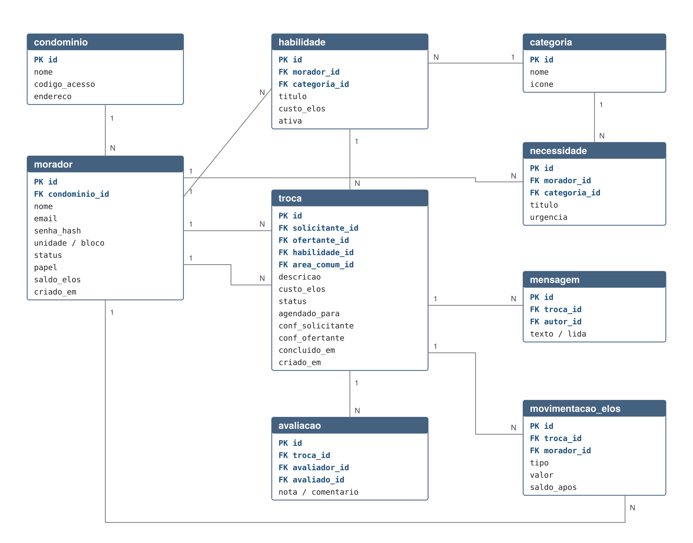

# Trocaí

Aplicativo de troca de habilidades entre moradores de condomínios, com créditos
virtuais e sem dinheiro envolvido.

Projeto acadêmico do curso de **Desenvolvimento de Software Multiplataforma** da
**Fatec Osasco Prefeito Hirant Sanazar** — 6º semestre, 2026.

O código-fonte está em [`api/`](api/) · a documentação das entregas, em
[`docs/entregas/`](docs/entregas/) · o registro do workshop, em
[`docs/lean-inception/`](docs/lean-inception/).

---

## O problema

Condomínios verticais concentram, em poucos metros quadrados, uma diversidade
enorme de competências que permanece invisível. O morador contrata um técnico
pela internet sem saber que o vizinho do 22A é técnico em eletrônica aposentado;
o aposentado conserta o ventilador de quem passa no corredor e nunca recebe nada
de volta. O grupo de WhatsApp não resolve: pedidos se perdem no volume, não há
histórico e não existe mecanismo de reciprocidade.

## A solução

O morador cadastra o que sabe fazer e o que precisa. O aplicativo conecta oferta
e demanda **dentro do próprio condomínio** e registra cada troca em créditos
chamados **Elos**: quem ensina acumula, quem aprende gasta. O encontro é combinado
por chat interno e acontece nas áreas comuns.

Um painel web entrega ao síndico o ranking de moradores ativos, a gestão de avisos
e bloqueios e a **Árvore de Talentos**, que mostra quais habilidades faltam na
comunidade.

**Nenhuma etapa envolve dinheiro real.** Os Elos não podem ser comprados, vendidos
nem convertidos.

---

## Equipe

| Integrante | RA |
|---|---|
| Jefferson de Padua Coelho Ribeiro | 2161392413009 |
| Karine Fernandes e Silva | 2161392413030 |
| Sarah Quinteiro Limeira da Silva | 2161392413027 |

Orientação: Professor Elias Carneiro de Oliveira

---

## Documentação

O levantamento de requisitos seguiu a metodologia **Lean Inception**, de Paulo
Caroli. Cada funcionalidade proposta é rastreável até uma oportunidade de uma
jornada, que pertence a uma persona, que responde a um objetivo de negócio.

### Entregas

Cada entrega tem o documento que a descreve e o artefato que ela produziu. A
Entrega 4 é o código em si.

| # | Objetivo | Documento | Artefato no repositório |
|---|---|---|---|
| 1 | Histórias de usuário e casos de uso | [PDF](docs/entregas/Trocai_Entrega1_Objetivo1.pdf) | [Diagrama de casos de uso](docs/diagramas/uc.png) |
| 2 | Protótipo e UX/UI | [PDF](docs/entregas/Trocai_Entrega2_Objetivo2.pdf) | [Telas](docs/diagramas/telas1.png) · [Navegação](docs/diagramas/nav.png) |
| 3 | Estrutura do banco de dados | [PDF](docs/entregas/Trocai_Entrega3_Objetivo3.pdf) | [Migrações SQL](api/src/db/migracoes/) · [MER](docs/diagramas/mer.png) |
| 4 | **Implementação** | [PDF](docs/entregas/Trocai_Entrega4_Objetivo4.pdf) | **[Código-fonte da API](api/src/)** |
| 5 | Testes e validação | [PDF](docs/entregas/Trocai_Entrega5_Objetivo5.pdf) | [Suíte de testes](api/testes/) |
| 6 | Documento consolidado e pitch | [PDF](docs/entregas/Trocai_Entrega6_Objetivo6.pdf) | este repositório |

O PDF da Entrega 4 documenta a arquitetura, os 32 endpoints e as decisões
técnicas por trás deles; o código que ele descreve está em
[`api/`](api/), com as instruções de execução no
[README da API](api/README.md).

### Pesquisa de validação

A página em [`pesquisa/`](pesquisa/) apresenta as seis telas da Onda 1 a moradores
e registra o que cada um entendeu de cada tela, mais a escala SUS. É o
instrumento da validação remota descrita na Entrega 5. Publicada pelo GitHub
Pages, abre em qualquer celular sem instalação nem cadastro.

### Atividades da Lean Inception

Registro de cada atividade do workshop, em [`docs/lean-inception/`](docs/lean-inception/):
kick-off e visão do produto, personas, jornada do usuário, brainstorming de
funcionalidades, revisão técnica de negócio e de UX, e o sequenciador de ondas.

Quadro colaborativo da equipe no FigJam:
<https://www.figma.com/board/l38wvAOPWyFd29ancA8F7p/LDDM---Troca%C3%AD>

---

## Artefatos visuais

| Diagrama | Arquivo |
|---|---|
| Casos de uso | [uc.png](docs/diagramas/uc.png) |
| Fluxo de navegação | [nav.png](docs/diagramas/nav.png) |
| Modelo entidade-relacionamento | [mer.png](docs/diagramas/mer.png) |
| Arquitetura em camadas | [arq.png](docs/diagramas/arq.png) |
| Telas do aplicativo | [telas1.png](docs/diagramas/telas1.png) · [telas2.png](docs/diagramas/telas2.png) |



---

## Código

A pasta [`api/`](api/) traz a implementação do núcleo do produto: autenticação
com aprovação pelo síndico, catálogo de habilidades com busca, ciclo de vida da
troca, carteira de Elos com custódia e livro-razão imutável, chat da troca,
avaliação, moderação e o painel do síndico. São 32 endpoints, o esquema do
PostgreSQL em migrações versionadas e os testes que verificam a regra.

O [README da API](api/README.md) detalha endpoints, códigos de resposta e as
decisões técnicas.

```bash
cd api
npm install
npm test               # 76 testes
npm run demonstracao   # percorre uma troca inteira, sem precisar de banco
```

`npm run demonstracao` sobe a API sobre o banco em memória e executa o fluxo
completo — cadastro, aprovação, busca, pedido, aceite, chat, dupla confirmação,
extrato, auditoria e avaliação —, imprimindo o que acontece com os saldos a
cada passo. É a forma mais rápida de ver o produto funcionando.

### Resultado da última execução

```
Test Suites: 4 passed, 4 total
Tests:       76 passed, 76 total
Cobertura:   90,52% instruções · 78,29% ramos · 97,50% funções · 92,27% linhas
```

O banco usado nos testes é uma implementação em memória que reproduz o
comportamento transacional do PostgreSQL: em caso de exceção o estado volta ao
ponto anterior ao início da transação. É isso que permite verificar a reversão
de uma transferência interrompida sem subir um banco real.

### A regra que sustenta o produto

A transferência de créditos é a operação de maior risco do sistema. Se o saldo
divergir uma única vez, a confiança na economia interna acaba e não há como
recuperá-la. Por isso:

- os créditos ficam **em custódia** entre o aceite e a conclusão;
- a transferência só acontece após a **confirmação das duas partes**;
- debitar e creditar ocorrem na **mesma transação** — ou os dois, ou nenhum;
- as linhas são travadas sempre em **ordem crescente de identificador**, para não
  gerar impasse entre duas trocas simultâneas entre as mesmas pessoas;
- o livro-razão é **imutável**: só aceita inserção, nunca alteração ou exclusão.

Um dos testes verifica o invariante global: o total de Elos em circulação no
condomínio não muda depois de uma troca concluída.

---

## Tecnologias

| Camada | Tecnologia |
|---|---|
| Aplicativo | Flutter / Dart |
| Painel web | React / TypeScript |
| API | Node.js / Express |
| Banco de dados | PostgreSQL |
| Testes | Jest |
| Notificações | Firebase Cloud Messaging |
| Design | Figma / FigJam |

PostgreSQL foi escolhido em vez de uma base NoSQL gerenciada por causa das
transações ACID, indispensáveis para a carteira de créditos.

---

## Limitações conhecidas

Registradas de forma deliberada na documentação, não descobertas por acaso:

**Liquidez.** Em um prédio de 96 unidades com 40% de adesão há cerca de 38
usuários. Como cada morador precisa de uma habilidade específica poucas vezes por
ano, o volume realista fica entre 5 e 8 trocas mensais. Um aplicativo aberto uma
vez a cada dois meses não retém ninguém. A resposta do projeto foi incluir
**oficinas abertas**, em que uma oferta atende vários moradores de uma vez.

**Modelo de negócio.** O produto proíbe dinheiro por definição, então a receita
não vem do morador. Vender assinatura ao condomínio é possível, mas cada contrato
depende de aprovação em assembleia. A alternativa avaliada é integrar-se como
módulo de uma plataforma de gestão condominial já existente.

**Escopo técnico.** Ficaram para ondas futuras o chat em tempo real, as
notificações push e a Árvore de Talentos em sua forma visual completa. Nos três
casos a versão simples entrega a maior parte do valor com risco técnico muito
menor.

**Uma decisão do sequenciador foi revista na implementação.** A retenção de
créditos em custódia havia sido empurrada para uma onda futura, com o argumento
de que protegia um caso de borda raro em um piloto de 38 usuários. Ao escrever a
transferência ficou claro que o adiamento não economizava nada: garantir que o
mesmo crédito não fosse prometido a duas trocas exigia travar as linhas e manter
o lançamento duplo de qualquer forma, que é o grosso do trabalho da custódia. Ela
entrou na Onda 1 e está implementada — a divergência fica registrada aqui em vez
de corrigida no documento do sequenciador, que é o registro do que o time decidiu
naquela sessão.

---

## Licença

MIT — ver [LICENSE](LICENSE).
